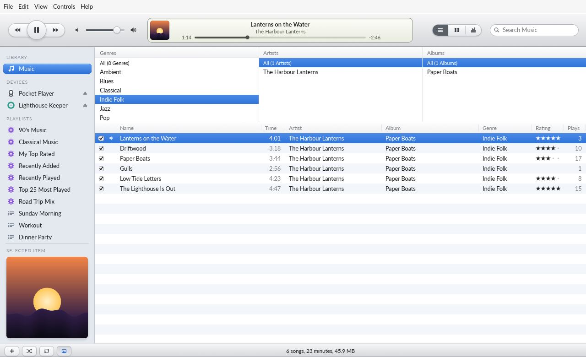
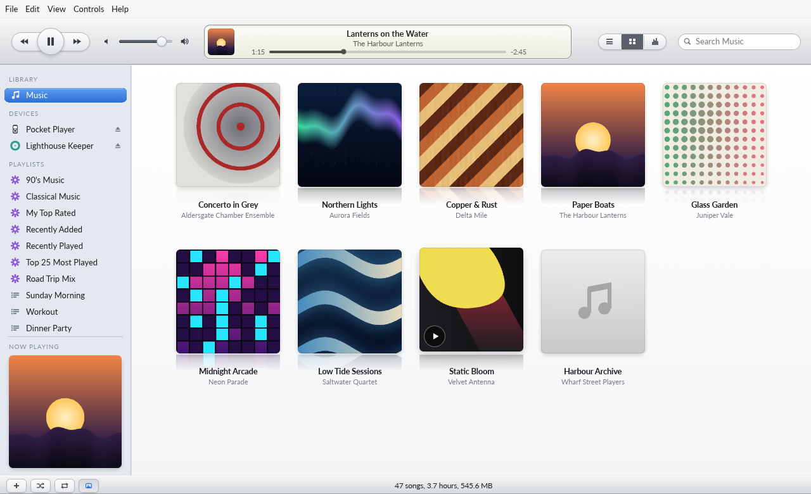
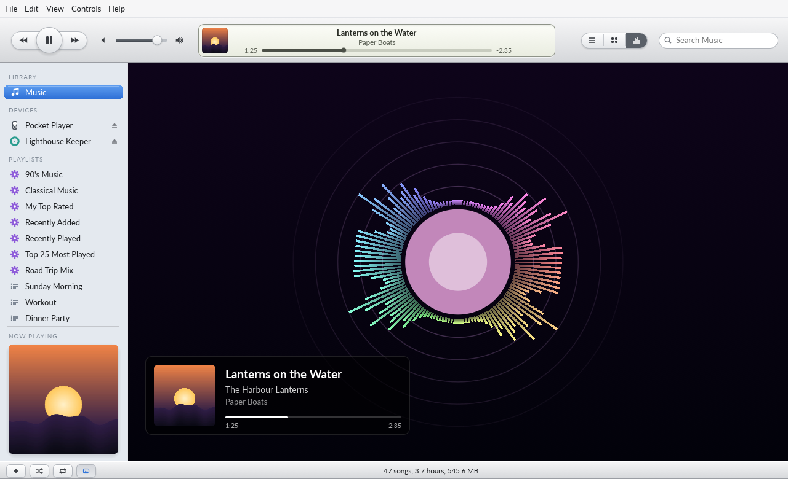
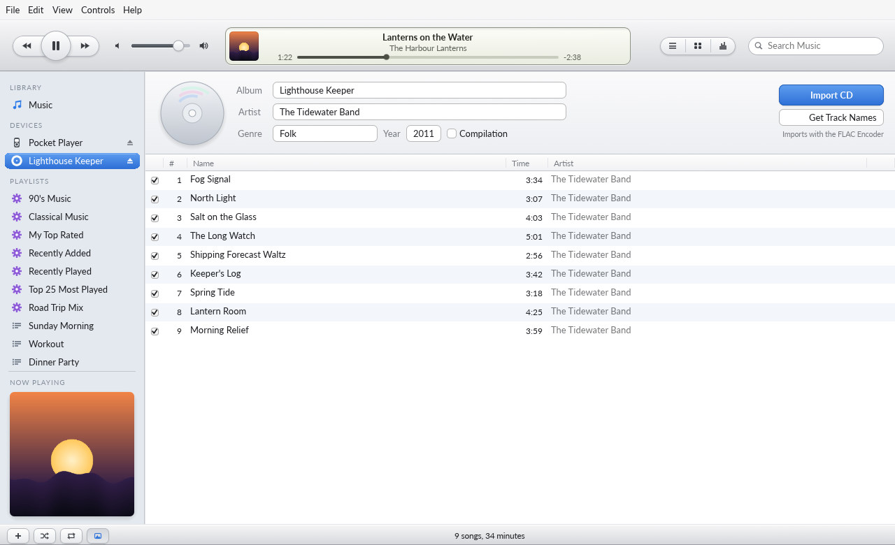
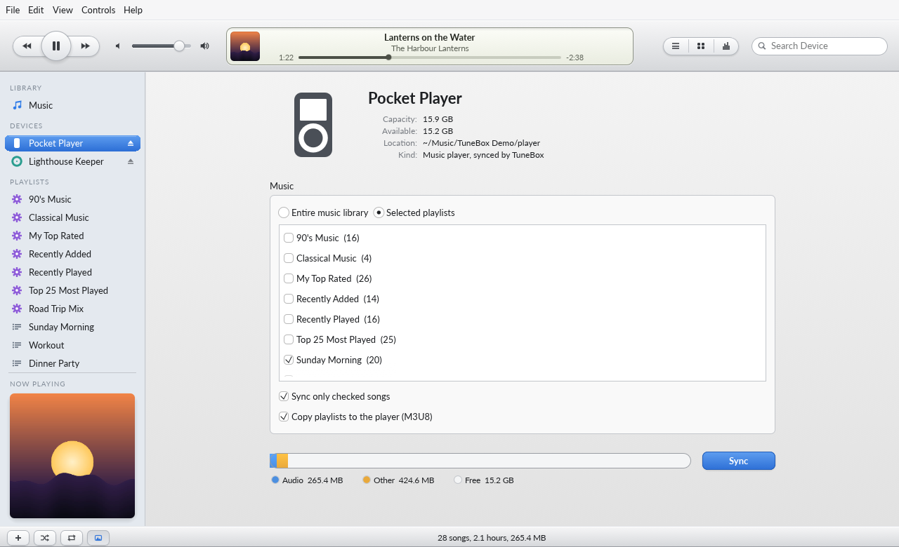
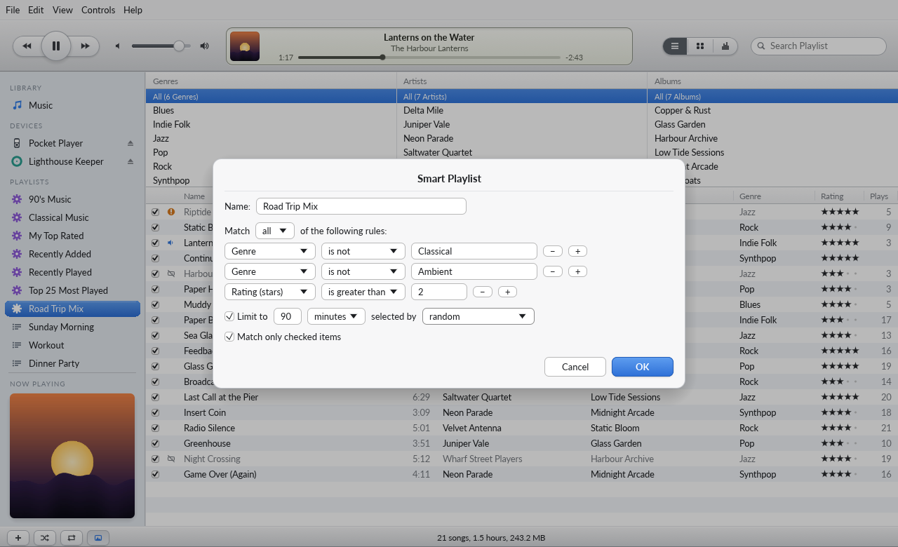
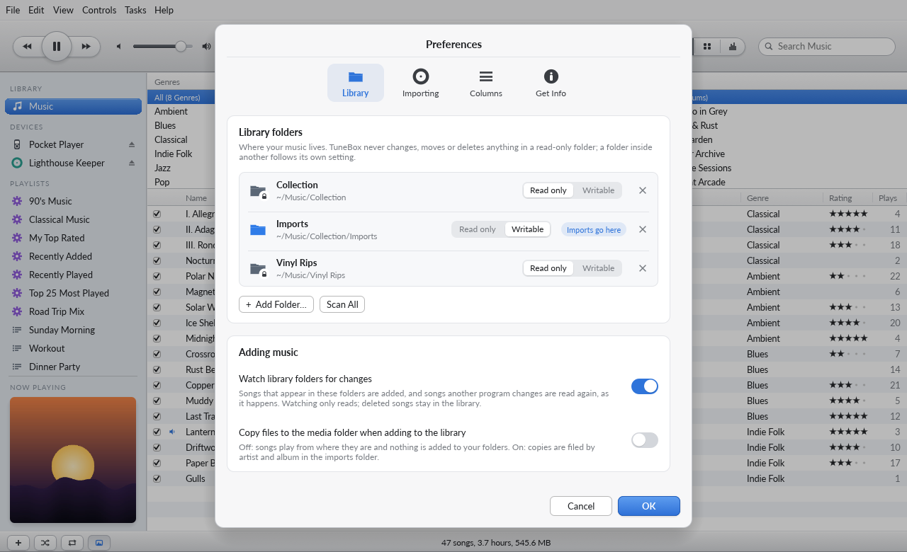

<h1 align="center">TuneBox</h1>

<p align="center">
  <b>Your music library, CD importing and player syncing, in a fast native app written in Rust.</b><br>
  The classic desktop jukebox (think iTunes 10 and earlier), music only: no video, no store, no account.<br>
  macOS · Windows · Linux
</p>

<p align="center">
  
</p>

> The pictures show a demo library of made-up albums whose covers TuneBox draws itself
> (`cargo xtask demo`). No real artists or artwork appear anywhere in this repository.

## What it does

- **Library.** Add folders of MP3, AAC, ALAC, FLAC, WAV, AIFF and Ogg Vorbis. Songs are played
  from where they are. Optionally, copies are filed by artist and album in a media folder.
  Sort by any of 20 columns, browse by genre, artist and album, search as you type, rate with
  stars, uncheck songs to skip them, and edit details for one song or many at once: the
  everyday fields up front, and 31 more (credits, classical, release, sort names, lyrics…)
  under *Show all fields*, with the ones you use pinned in Preferences.
- **Playlists and smart playlists.** Drag songs onto playlists. Smart playlists match rules on
  text, numbers and dates, can be limited by count, time or size, and stay up to date as you
  listen.
- **Playback.** A dedicated player thread with a lock-free path to the sound card, shuffle,
  repeat one or all, and play and skip counts. The status display shows what's playing and what's being
  imported or synced.
- **Visualizer.** Five looks (Spectrum, Aurora, Pulse, Oscilloscope, Hyperspace), driven by what
  the sound card is playing, with an optional track-info card. Writing a new look is one file
  ([docs/visualizers.md](docs/visualizers.md)).
- **CDs.** See the disc, fetch its track names from MusicBrainz (only when you ask), edit them
  and import to FLAC, WAV or AIFF.
- **Players.** Any player that mounts as a drive (Rockbox, FiiO, Sony, Shanling…): pick the
  whole library or chosen playlists, see what fits, and sync. Only changes are copied, playlists
  are written as M3U8, and only files TuneBox put there are ever removed.
- **Library folders stay in step.** Songs copied into a library folder appear in the library,
  tags changed by another program are read again, and a renamed folder keeps its songs'
  ratings and play counts. Watching only reads. Songs whose files are gone are marked, and
  songs on a NAS or drive that is not connected are marked differently and wait for it to come
  back; a share that stops answering never freezes the app.
- **Your files are safe.** Nothing is written to your music folder unless you edit a song's
  details or ask for a file to be deleted, and you can list any number of library folders, each strictly read-only or writable (for
  example a read-only collection with a writable imports folder inside it).
  The library lives in the application data folder. See [docs/files.md](docs/files.md).

<table>
<tr>
<td width="50%"></td>
<td width="50%"></td>
</tr>
<tr>
<td align="center"><sub>The album grid</sub></td>
<td align="center"><sub>The Pulse visualizer with track info</sub></td>
</tr>
<tr>
<td width="50%"></td>
<td width="50%"></td>
</tr>
<tr>
<td align="center"><sub>Importing a CD</sub></td>
<td align="center"><sub>Syncing a player</sub></td>
</tr>
<tr>
<td width="50%"></td>
<td width="50%"></td>
</tr>
<tr>
<td align="center"><sub>Smart playlist rules</sub></td>
<td align="center"><sub>Read-only and writable library folders</sub></td>
</tr>
</table>

What exists and what is planned, feature by feature: [docs/feature-parity.md](docs/feature-parity.md).

## Get started

Building needs Rust 1.95 or later. On Linux, also the ALSA development files
(`libasound2-dev` on Debian and Ubuntu, `alsa-lib-devel` on Fedora).

```sh
cargo run --release -p tunebox                    # the app
cargo run --release -p tunebox-cli -- --help      # the same features from the command line
cargo xtask demo                                  # build the demo library (~/Music/TuneBox Demo)
cargo run --release -p tunebox -- --demo ~/Music/TuneBox\ Demo   # try it with a virtual CD and player
```

The command line reaches every library feature without the window. Commands that only read
(`list`, `info`, `stats`…) work while the app is open; commands that change the library wait
for it to be closed, so the two never save over each other.

```sh
tunebox-cli import ~/Music/Albums
tunebox-cli list --search "harbour"
tunebox-cli new-playlist "Evening" --search jazz
tunebox-cli edit "Paper Boats" --set label="Lanternlight Records" --set release-date=1997-01-01
tunebox-cli info-fields --pin label --pin release-date          # always shown in Get Info
tunebox-cli refresh --search "Paper Boats"                      # re-read tags another app changed
tunebox-cli missing                                             # songs whose files are gone or offline
tunebox-cli locate "Driftwood" ~/Music/Moved/Driftwood.flac     # point a missing song at its file
tunebox-cli cd-import --lookup
tunebox-cli sync /media/me/PLAYER --playlist Evening
tunebox-cli folders add ~/Music/Collection                    # read only: never written to
tunebox-cli folders add ~/Music/Collection/Imports --writable
tunebox-cli folders imports ~/Music/Collection/Imports        # CD rips go here
tunebox-cli folders watch                                     # keep the library in step
```

## How it's built

A Cargo workspace of small, layered crates. The core never depends on the interface, and
everything the app does is an engine call first, so the command line and tests drive exactly
what the window does. Details: [docs/architecture.md](docs/architecture.md).

| Crate | What it does |
|---|---|
| `tunebox-model` | Tracks, playlists, smart playlist rules, columns, sorting, search. Pure |
| `tunebox-library` | The collection, the column browser, the versioned library file (atomic saves) |
| `tunebox-tags` | Tags and artwork in every supported format (lofty), written atomically |
| `tunebox-audio` | Streaming decode and lossless encoding through [craft-audio](https://github.com/storytold/craft-libs) (symphonia) |
| `tunebox-import` | Finding music and filing copies |
| `tunebox-playback` | Play queue, player thread, sound output (cpal), spectrum analysis |
| `tunebox-rip` | CD drives (cd-da-reader), disc ids, MusicBrainz, ripping |
| `tunebox-sync` | Recognising players, planning and carrying out syncs |
| `tunebox-engine` | The `Session` façade, background jobs, preferences, command registry |
| `tunebox-platform` | Folders, mounted volumes, reveal and eject |
| `tunebox-visualizer` | The `Visualizer` trait, the audio meter and the built-in looks |
| `tunebox-ui` | The egui desktop interface |

**Quality gates** (`cargo xtask ci`): formatting, Clippy with warnings as errors, 179
unit and end-to-end tests, the crate layering check, and dependency licences
(`cargo deny`). No `unsafe`, and no `unwrap`/`expect`/`panic!` outside tests. Contributors and
agents follow [AGENTS.md](AGENTS.md).

TuneBox follows the principles of the Craft apps ([PdfCraft](https://github.com/storytold/pdfcraft)
and its siblings): a layered pure-Rust workspace, an engine façade, everything reachable
headlessly, crash-free by policy, and clean-room behaviour. Its look is its own, drawn in code: modern-retro, with the classic jukebox's anatomy (brushed toolbar, status display, blue source list, striped list) and today's manners (rounded selections, soft shadows, covers with reflections, dimmed dialogs).

## Licence

MIT OR Apache-2.0. Third-party material: [ATTRIBUTION.md](ATTRIBUTION.md).
