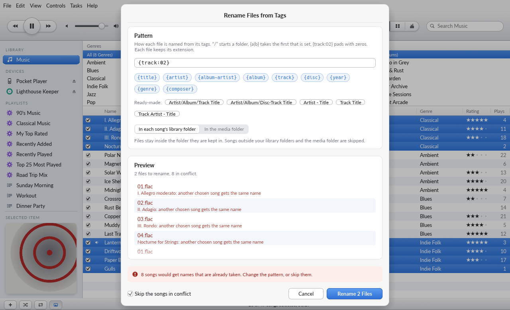

# What TuneBox does with your files

Your music folders are yours. TuneBox reads them; it writes to them only when you ask it to
change a song, and never to a folder you mark read-only.

## Where TuneBox keeps its own files

| What | Where | Notes |
|---|---|---|
| Library (songs, playlists, ratings, play counts) | Application data folder: `~/.local/share/TuneBox/` (Linux), `~/Library/Application Support/TuneBox/` (macOS), `%APPDATA%\TuneBox\` (Windows) | Not in your music folder |
| Preferences | The same folder | |
| `TuneBox Library.lock` | Beside the library | Keeps a second TuneBox (the app or `tunebox-cli`) from opening the same library and saving over its changes. `tunebox-cli` commands that only read (`list`, `info`, `stats`, `playlists`, `folders`, `info-fields`, `artwork export`) do not need it: they read the library as last saved, so they work while the app is open. The operating system releases it when TuneBox quits or crashes, so it never needs deleting |
| `TuneBox Artwork/` | Beside the library | Covers you chose for songs in read-only folders, one picture per album (see below). Created only when needed |
| Media folder | `~/Music/TuneBox Media` by default, changeable | **Created only when needed**: for CD imports, or if you turn on copying when adding music |

Ratings, play counts, skip counts and checkboxes live only in the library file. Playing,
browsing, rating and making playlists never touch a music file.

## What can change a music file

| Action | What happens on disk |
|---|---|
| Add to Library | **Nothing.** Songs are played from where they are. If you turn on *Copy files to the TuneBox Media folder*, copies are made in the media folder; the originals are not touched |
| Get Info ▸ edit details | The details are written into the song's tags. Only fields you changed are written: the additional fields (credits, label, sort names, lyrics…) you did not touch stay exactly as they are, and a field the format has no place for is not offered. The edit is made on a hidden copy next to the file (`.tunebox-edit-…`) that replaces the original only when complete, so a crash or full disk cannot damage the song |
| Watching library folders | **Nothing.** New songs are added to the library, changed songs are read again, a moved song is relinked (keeping its ratings and plays), and a deleted song stays in the library |
| Find Album Artwork… / Get CD Cover | The same as Choose Artwork, with a cover from the Cover Art Archive: nothing changes until you pick a release (or, for a CD, until its songs are imported). See [Covers from the internet](#covers-from-the-internet) |
| Choose Artwork / Remove Artwork | The cover is written into (or every picture removed from) each chosen song's tags, through the same hidden copy as Get Info edits, one song at a time in the background. A song that cannot be written is reported and left as it is; the others carry on. JPEG and PNG pictures go in byte for byte; other images are converted, and pictures over 1400 pixels scaled down, so each song grows by a few hundred kilobytes at most. Missing songs and songs on a drive or share that is not connected are skipped, untouched. Songs in a read-only folder: see below |
| Refresh from Files | **Nothing.** The songs' tags are read again and the library takes what they say |
| Tasks ▸ Rename Files from Tags… | Renames the chosen songs' files, and moves them into folders, by a pattern built from their tags. Only after a preview, and only inside the library folder each song is in or inside the media folder. See [Renaming files](#renaming-files-from-tags) |
| Delete from Library | Removes the song from the library. The file is deleted only if you tick *Also delete the files from disk* |
| Import CD | New files in the media folder. A track appears only when it is complete (written as `*.part`, then renamed); a cancelled or failed track leaves nothing |
| Sync a player | Writes only to the player: music under `Music/`, playlists under `Playlists/`, and `.tunebox/device.json`, which records what TuneBox put there (on MTP players, which cannot replace a file in one step, `.tunebox/device-<n>.json`: the new copy is written before the old is removed). Sync deletes only files it put there itself, and a song cut off by an unplugged player is listed as unfinished and removed by the next sync, never taken for a synced song |

Temporary files (`*.part`, `.tunebox-edit-*`, `.tunebox-rename-*`) are removed when an operation fails or is
cancelled.

## Renaming files from tags

**Tasks ▸ Rename Files from Tags…** (or `tunebox-cli rename`) names the selected songs' files by
a pattern such as `{album-artist|artist}/{album}/{track:02} {title}`. It is the one thing in
TuneBox that moves your files, so it is careful:

| What | What happens on disk |
|---|---|
| The preview | **Nothing.** Every song is listed with its new name, or with why it is left alone. Renaming is planned again when you confirm, and refused if anything changed since the preview |
| A song is renamed | The file is renamed, or moved into the folders the pattern names (created as needed), inside the library folder the song is in or inside the media folder, as you choose. The song keeps its ratings, plays, playlists and edits |
| A name is taken | **Nothing happens to either file.** Two chosen songs that would get one name, a file already there, or another song in the library with that name: the songs are *in conflict*, and nothing is renamed until you change the pattern or choose to skip them. A file is never replaced, even if one appears after the preview |
| Names differing only in case | Compared as the disk compares them: on Windows and macOS `Intro.flac` and `intro.flac` clash. A rename that only changes case goes through a hidden `.tunebox-rename-…` name in between |
| Files that go with a song | Lyrics, cue sheets and notes with the song's file name (`01 Song.lrc`, `.cue`, `.txt`, `.elrc`, `.nfo`) move with it and take its new name. One whose new name is taken stays where it was. A cue sheet's contents are not rewritten |
| Folders left empty | Removed, but only when truly empty (a hidden file keeps a folder), never a library folder or the media folder itself, and never outside them |
| Read-only folders | Songs in them, and moves into them, are skipped. Nothing in them changes |
| Missing or not-connected songs | Skipped. A song on a share that is not connected is not touched at all |
| Another drive | Refused, not copied: renaming only ever moves a file within its drive |
| A rename fails | That song is reported and stays where it was; the others go on. However the rename ends (finished, cancelled, stopped by an error, or TuneBox quitting), the library points at where each file really is |



While a rename runs, the folder watcher, imports and refreshes wait for it, so renamed files are
never taken for new songs. Renaming happens only when you ask; TuneBox does not yet rename files
by itself when you edit their tags.

The rules live in `crates/engine/src/rename/` (planning is a pure function with its own tests)
and the moves in `crates/engine/src/files.rs`. The tests in `crates/engine/tests/session.rs`
whose names start with `renam` (and `a_rename_…`, `one_failed_rename_…`, `a_stale_preview_…`)
rename albums, check read-only folders byte for byte, and run the folder watcher alongside.

## Library folders, read-only or writable

**Preferences ▸ Library ▸ Library folders** lists the folders your music lives in. You can list
as many as you like, and each is **read only** (the default for a new folder) or **writable**:

- In a **read-only** folder TuneBox never creates, changes, moves or deletes anything. Edits
  from Get Info are kept in the library only (you are told once); *Delete from Library* removes
  songs from the library and leaves their files; copies and CD imports refuse to go there.
- **Artwork** for songs in a read-only folder is kept by TuneBox, in `TuneBox Artwork/` beside
  the library: one picture per album (album artist and album name), shown as the cover of the
  album's read-only songs. Their files stay as they are. *Remove Artwork* forgets the kept
  picture; a cover inside such a file stays, and you are told so. Songs without an album name
  get no kept cover, since there is no album to keep it by.
- In a **writable** folder TuneBox may write edited details and artwork into songs, delete files you ask it
  to delete, and put CD imports and copies there (*Use for Imports*).
- **The deepest listed folder decides.** A typical setup is a curated collection that is read
  only, with a writable `Imports` folder inside it (or anywhere else) for CD rips:

  | Folder | Rule |
  |---|---|
  | `~/Music/Collection` | read only |
  | `~/Music/Collection/Imports` | writable, imports go here |
  | `~/Music/Vinyl Rips` | read only |

- Songs from folders that are not listed (added with *Add to Library* from anywhere) are
  writable, as they always were.
- *Scan All* (or File ▸ Scan Library Folders) adds songs that appeared in the folders since the
  last scan. Songs already in the library are left alone, with one exception that only reads:
  songs added before TuneBox read the additional tag fields (credits, label, sort names…) have
  those read from their files once. Anything you edited in TuneBox is kept.

From the command line:

```sh
tunebox-cli folders add ~/Music/Collection                       # read only, and add its songs
tunebox-cli folders add ~/Music/Collection/Imports --writable
tunebox-cli folders imports ~/Music/Collection/Imports           # CD imports go here
tunebox-cli folders scan
tunebox-cli folders                                              # list them
```

The rule lives in one place, `crates/engine/src/files.rs`, which every write in the engine goes
through. Symbolic links are resolved, so a link into a read-only folder is read only too. The
tests `a_read_only_library_folder_is_never_changed` and
`a_writable_imports_folder_inside_a_read_only_collection` (`crates/engine/tests/session.rs`)
edit, delete, import and rip, and check read-only folders byte for byte.

## Missing files and network drives

TuneBox looks for every song's file in the background and marks the ones it cannot play:

| Mark | Means | What TuneBox does |
|---|---|---|
| Amber **!** | **Missing**: the drive or folder is there, the file is not (moved, renamed or deleted) | Skips it when playing a list; says why if you play it. If the file turns up elsewhere in a library folder it is relinked, ratings and plays kept |
| Drive struck through | **Not connected**: the drive or network share it is on cannot be reached | The same, and nothing about it is treated as gone: it plays again once the place is back |

Neither ever removes a song from the library. Hover over a marked song to see why it is marked.

**Locate…** links a missing song to its file where it is now: from the song's menu, File ▸
Locate…, Get Info, or by playing it. Only where the file is and its facts (length, size)
change; ratings, plays, playlists and edits stay, and nothing is written to any file. TuneBox
then works out how the path moved (`/old/Music/…` → `/new/Music/…`) and links the other
missing songs that moved the same way, each only if a file of the same size and format is at
its new place, so a different song with the same name is never taken for it.

**Network drives are remembered.** When a network share (NFS, SMB, AFP, WebDAV, SSHFS…) holds
library songs, the library file records it as a network place. Later, a share that is not
mounted reads as *not connected* without TuneBox touching it, even when its mount point is left
behind as an empty folder (as on Linux), which would otherwise look like a folder of deleted
songs. On Windows, network paths (`\\server\share`) are always network places, and mapped
network drive letters (`Z:`) are recognised from the user's mappings (`net use`), including a
mapping whose server is away. Either is asked directly, within the deadline: a drive letter
can stay mapped while its server is off.

**A share that stops answering never freezes TuneBox.** Every look at a drive or share runs on a
background thread with a deadline of a few seconds; a place that does not answer in time is
treated as not connected until it does. Places are asked again every 30 seconds and whenever
mounts change, and you are told when one disconnects or comes back.

**Syncing with a share offline** keeps the player's copies of its songs as they are: a song that
cannot be read is never deleted from the player and never re-copied. Refresh from Files leaves
those songs alone too.

`tunebox-cli missing` lists missing songs, and songs on each place that is not connected;
`tunebox-cli locate <search> <file>` links one.

## Covers from the internet

TuneBox fetches covers only when you ask: **Find Album Artwork…** (album grid menu, Edit menu,
Get Info's *Find Online…*), **Get CD Cover** on the CD page, or the Preferences ▸ Importing
switch *Get the cover when track names are found*, which is off until you turn it on. What is
sent, and to whom:

| Request | Sent to | What it carries | When |
|---|---|---|---|
| CD names | musicbrainz.org | The disc id | Get Track Names, or *Look up track names when a disc is inserted* |
| Album search | musicbrainz.org | The artist and album title in the search box | Find Album Artwork… (and Search in it) |
| Thumbnails | coverartarchive.org, redirected to archive.org | The release ids MusicBrainz returned | While the picker shows them, one at a time |
| The cover | coverartarchive.org, redirected to archive.org | The chosen release's id (or the CD's) | Use Cover, Get CD Cover, or the switch above |

Every request names TuneBox in its user agent (as MusicBrainz asks), is spaced at least a
second apart for MusicBrainz, and gives up after 40 seconds; replies larger than expected are
refused. Nothing else about you or your library is sent, and replies are remembered only for
the session (in memory), so going back and forth does not ask again.

TuneBox keeps the 1200-pixel version of a cover: sharper than any player shows it, below the
1400-pixel limit for covers so it is stored as served, and a few hundred kilobytes rather than
the multi-megabyte original scan in every song. A release with no cover of its own gets its
release group's (the album's cover, from another edition), and TuneBox says so. A cover then
goes into the songs exactly as a picture you chose would, read-only folders included.

## Artwork from the command line

```sh
tunebox-cli artwork set "Lanterns" ~/Pictures/lanterns.jpg   # every song matching the search
tunebox-cli artwork remove "Lanterns"
tunebox-cli artwork export "Lanterns" ~/Desktop/cover.jpg     # reads only: works while the app is open
```

`artwork export` saves the cover as it is stored (JPEG or PNG), and refuses to write into a
read-only folder.

```sh
tunebox-cli artwork find "Paper Boats"              # the album's releases on MusicBrainz, with ids
tunebox-cli artwork fetch "Paper Boats" --release 9a9e7b0a-…   # that release's cover into the songs
tunebox-cli cd-import --lookup --cover              # names and cover from the internet, then import
```

`artwork find` changes nothing; `--artist` and `--album` search for other words than the
songs' tags. The test `a_cover_goes_into_every_writable_song_and_is_kept_for_read_only_ones`
(`crates/engine/tests/session.rs`) checks the read-only folder byte for byte.
