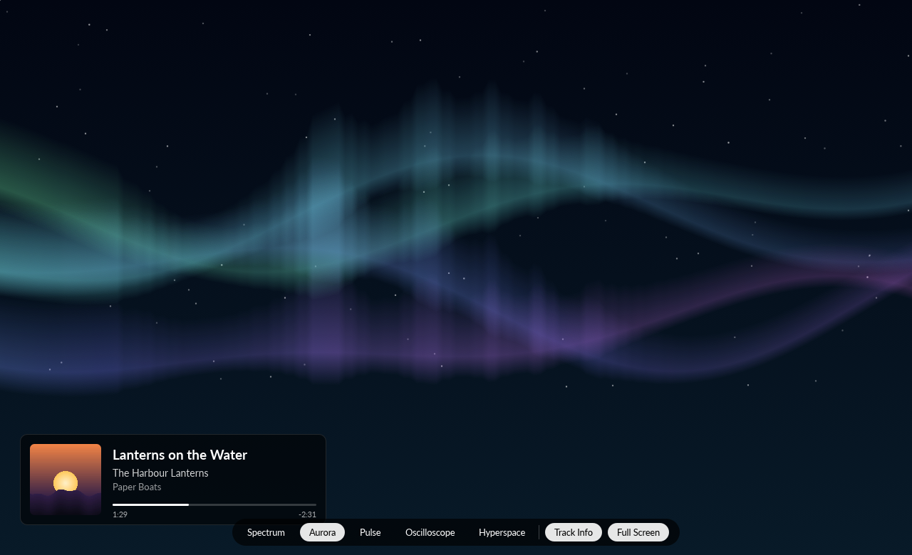

# Writing a visualizer

There are two ways to add a look:

- **A plug-in** loaded at run time: a WebAssembly module in TuneBox's `Visualizers` folder,
  written with `tunebox-visualizer-sdk`. No rebuild of TuneBox, and it runs in a sandbox. See
  [visualizer-plugins.md](visualizer-plugins.md).
- **Compiled in**: a Rust type in this repository or in a crate that starts TuneBox, painting
  with egui directly. This page describes that, and the `Frame` both kinds receive.

A compiled-in visualizer ("look") is a type that implements one trait,
`tunebox_visualizer::Visualizer`:

```rust
pub trait Visualizer {
    fn id(&self) -> &str;   // stable, saved in preferences: "lava-lamp"
    fn name(&self) -> &str; // shown in the picker: "Lava Lamp"
    fn paint(&mut self, painter: &Painter, rect: Rect, frame: &Frame);
}
```

`paint` is called every frame (about 60 times a second) while the visualizer shows. It draws
into `rect` with an [egui `Painter`](https://docs.rs/egui/latest/egui/struct.Painter.html):
shapes, lines, text and meshes with per-vertex colours for gradients and glows. It takes
`&mut self`, so a look can keep its own state (particles, a rotation).

## What a `Frame` tells you

| Field | Meaning |
|---|---|
| `bands` | 64 spectrum bands, 0–1, low to high frequency on a hearing-like scale. Smoothed: rise fast, fall slowly. `frame.band_at(0.0..=1.0)` picks one by position |
| `peaks` | Per band, a recent maximum that falls slowly: peak markers |
| `level` | Overall loudness, 0–1 |
| `bass` | Loudness of the lowest bands, 0–1: the beat |
| `waveforms` | The last six waveforms, oldest first, 256 samples each scaled to ±1. `frame.waveform()` is the newest |
| `time`, `dt` | Seconds since the visualizer opened, and since the last frame. Animate with these, never with wall-clock time |
| `playing` | Whether anything is playing. Looks keep moving gently when nothing is |

The meter (`tunebox_visualizer::Meter`) produces frames from the player's audio tap: the
samples the sound card has just played, mixed to mono, before the volume control. The FFT and
band mapping are in `tunebox_playback::analysis`.

`tunebox_visualizer::paint` has helpers: `hue(h, s, v, alpha)` for colours, `quad` for
gradient quads in a `Mesh`, `background` for a vertical gradient fill.

## Full screen

View ▸ Full Screen Visualizer (⇧⌘F, Ctrl+Shift+F elsewhere), the Full Screen control or a
double-click on the visualizer makes it fill the screen the window is on, with nothing else
showing. The pointer and the controls hide when the mouse has been still for 2.5 seconds and
come back when it moves; the track-info card behaves as in the window. The shortcuts for
play/pause, next, previous and volume work without leaving full screen; any other command
leaves first, so its result can be seen.

Escape, the same command, the Full Screen control or a double-click leaves, and the window
goes back to the size and place it had (maximized if it was), showing what it showed before,
the visualizer or not. If the system will not make the window full screen (no window manager,
say), the visualizer fills the window without the toolbar and source list instead. Full
screen is never saved: TuneBox always starts in a window.

For a look, full screen only means a bigger `rect`: draw relative to it, and keep the number
of shapes independent of its size.

The window bookkeeping is pure and tested in `crates/ui/src/full_screen.rs`.



(Taken under Xvfb, which has no window manager to grant full screen, so the picture shows the
fallback: the full-screen layout filling the window.)

## Adding a built-in look

1. Create `crates/visualizer/src/looks/<name>.rs` with a type implementing `Visualizer`.
   The existing looks (`spectrum.rs`, `aurora.rs`, `pulse.rs`, `scope.rs`, `hyperspace.rs`)
   are each one short file to copy from.
2. Add `mod <name>;` and one line to `builtin()` in `crates/visualizer/src/looks/mod.rs`.

That's all. The picker, preferences and screenshots pick it up from the registry, and the test
`every_builtin_paints_without_panicking` paints it once with real-looking data and once with
empty data.

## A look from another crate (compiled in)

A crate outside this repository can add looks without changing TuneBox: depend on
`tunebox-ui`, implement `Visualizer`, and start the app with them:

```rust
fn main() -> Result<(), String> {
    tunebox_ui::run_with(tunebox_ui::LaunchOptions::default(), vec![Box::new(LavaLamp)])
}
```

A complete, working example is `apps/tunebox/examples/lava_lamp.rs`
(`cargo run --example lava_lamp -p tunebox`). A look whose `id` matches a built-in replaces it.

### Compiled in or a run-time plug-in?

A compiled-in look is native code with the whole of egui to draw with, and it runs with all of
TuneBox's rights: it is for looks that ship with TuneBox or with a build of it. A run-time
plug-in needs no rebuild and cannot harm TuneBox (no `unsafe` loading of native libraries,
which TuneBox forbids), but draws through a small set of shapes. Plug-in looks appear in the
picker after the compiled-in ones, with ids starting `plugin:`, so a plug-in can never replace
a built-in look.

## Rules for looks

- Never panic: index with `get`, guard divisions (`frame.bands` may be empty).
- Stay cheap: a few thousand shapes per frame at most.
- Original artwork only, drawn in code. No images from other products.
